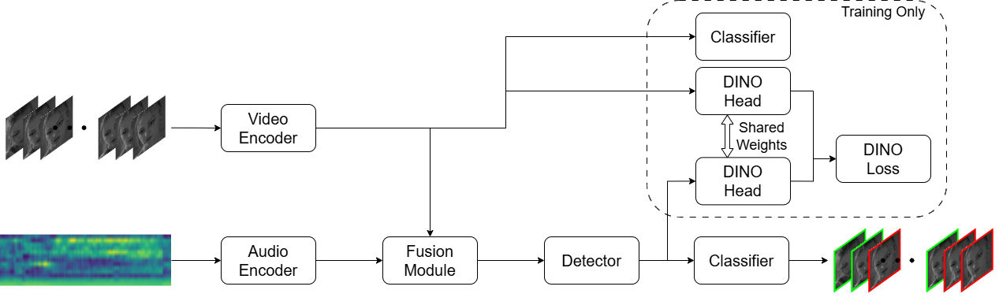
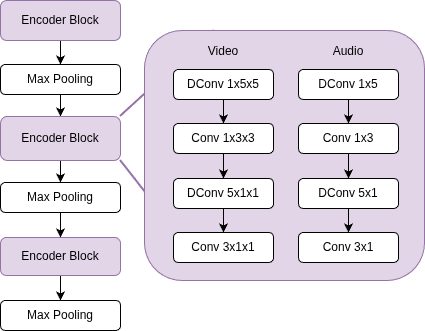

# LRX-ASD: Lightweight Active Speaker Detection

Official code for the ASILOMAR 2026 paper:

> **Active Speaker Detection in Crowded Collaborative Classroom Environments**<br>
> Sebastian Janampa, Wenjing Shi, Sylvia Celedon-Pattichis, Marios Pattichis<br>
> *Asilomar Conference on Signals, Systems, and Computers, 2026* (to appear)<br>
> [[paper]](TODO) [[weights]](https://github.com/SebastianJanampa/LRX-ASD/releases/tag/models_weight)

Active speaker detection (ASD) decides, for every frame of a face track, whether
that person is speaking. It is very hard in real collaborative classrooms: 4–5
small groups of 3–5 students talk at the same time, so each group microphone
picks up crosstalk from 20–25 speakers, and most faces are occluded or not
visible. The paper introduces:

1. **CLASD**, a real-life classroom ASD dataset: 2.5 hours of ground truth and
   1.8 M faces over four classroom settings, with heavy crosstalk and occlusions.
2. **LRX-ASD**, a lightweight ASD model with 0.50 M parameters and 0.23 GMACs.
   That is 40% fewer parameters and 55% fewer MACs than LR-ASD. LRX-ASD is
   competitive on AVA-ActiveSpeaker and Columbia, and it beats all compared
   methods on 3 of the 4 CLASD videos.
3. **A more efficient training pipeline**: mixed precision (AMP) and an EMA of
   the weights. It trains with 4000 frames per batch in under 12 GB of GPU memory.
4. **DINO self-distillation**: the fused audio-visual features act as the
   teacher for the visual features.

This repository contains the LRX-ASD model and its training pipeline. The
code is the `pyasd` library, which also includes the TalkNet, Light-ASD and
LR-ASD baselines behind the same API.

## Architecture

<p align="center"></p>

- **Encoders**: separate lightweight CNNs for video (112×112 grayscale face
  crops) and audio (13 MFCCs, 4 audio frames per video frame). Each encoder block
  uses depthwise convolutions for the large kernels and regular convolutions for
  the small ones, without biases, each followed by BatchNorm and ReLU.
  `model.deploy()` folds BatchNorm into the convolutions for inference.
- **Fusion module**: concatenates the audio and visual features along the
  channel dimension, then applies a linear projection.
- **Detector**: one unmasked transformer layer with 1D RoPE positional
  embeddings on the queries and keys.
- **Training-only heads**: a visual-only classifier, plus a DINO head (with
  weights shared between teacher and student) that distils the audio-visual
  output into the video encoder. The teacher temperature is 0.04, the student
  temperature 0.1, and the center momentum 0.9.

<p align="center"></p>

```
pyasd/
├── data/       # AVA-ActiveSpeaker loaders (MFCC audio + 112x112 grayscale faces)
├── engine/     # Model API (train / evaluate / infer), training loop, AVA & Columbia evaluation
├── models/     # lrxasd (ours), lrasd, lightasd, talknet, and the shared Criterion
├── optim/      # AdamW, EMA, AMP, LR schedulers
└── misc/       # distributed helpers
tools/          # entry points: train / eval_ava / eval_columbia / infer / pca_features
```

## Results

All models are trained on AVA-ActiveSpeaker. Columbia and CLASD are
out-of-distribution test sets.

**AVA-ActiveSpeaker** (validation set):

| Model | Single candidate | Pre-training | Params (M) ↓ | MACs (G) ↓ | mAP (%) ↑ |
|---|:-:|:-:|:-:|:-:|:-:|
| TalkNet | ✓ | ✓ | 15.74 | 1.53 | 92.3 |
| LoCoNet | ✗ | ✓ | 34.33 | 4.86 | **95.2** |
| BIAS | ✗ | ✗ | 31.6 | – | 92.4 |
| Light-ASD | ✓ | ✗ | 1.02 | 0.63 | 94.1 |
| LR-ASD | ✓ | ✗ | 0.84 | 0.51 | 94.5 |
| **LRX-ASD (ours)** | ✓ | ✗ | **0.50** | **0.23** | 93.8 |

**Columbia ASD** (F1, %):

| Model | Bell | Boll | Lieb | Long | Sick | Average |
|---|:-:|:-:|:-:|:-:|:-:|:-:|
| TalkNet | 87.7 | 78.5 | 89.3 | 87.25 | 81.2 | 84.9 |
| Light-ASD | 89.1 | 79.0 | 90.0 | 89.2 | 88.4 | 87.9 |
| LR-ASD | **91.6** | **81.4** | 90.2 | **90.1** | **87.3** | **88.8** |
| **LRX-ASD (ours)** | 90.3 | 80.2 | **91.3** | 89.4 | 87.0 | 88.2 |

**CLASD** (ours, F1, %):

| Model | Video 1 | Video 2 | Video 3 | Video 4 |
|---|:-:|:-:|:-:|:-:|
| TalkNet | 8.6 | 17.8 | 20.9 | 13.3 |
| Light-ASD | 26.3 | 33.1 | 36.0 | 29.9 |
| LR-ASD | 36.0 | 39.7 | **47.2** | 38.4 |
| **LRX-ASD (ours)** | **38.3** | **41.6** | 45.8 | **40.8** |

## Model zoo

| Model | `--model` | Params (deployed) | AVA val mAP (%) | Weights |
|---|---|:-:|:-:|---|
| **LRX-ASD** (paper) | `lrxasd` | 0.50 M | 93.8 | [lrx_asd.model](https://github.com/SebastianJanampa/LRX-ASD/releases/download/models_weight/lrx_asd.model) |
| LR-ASD | `lrasd` | 0.84 M | 94.5 | [lr_asd.model](https://github.com/SebastianJanampa/LRX-ASD/releases/download/models_weight/lr_asd.model) |
| Light-ASD | `lightasd` | 1.02 M | 94.1 | [light_asd.model](https://github.com/SebastianJanampa/LRX-ASD/releases/download/models_weight/light_asd.model) |
| TalkNet | `talknet` | 15.74 M | 92.3 | [talknet.model](https://github.com/SebastianJanampa/LRX-ASD/releases/download/models_weight/talknet.model) |

The mAP values are the paper's. All weights are on the
[GitHub release](https://github.com/SebastianJanampa/LRX-ASD/releases/tag/models_weight). Download them into a `weights/` folder:

```bash
mkdir -p weights
for m in lrx_asd lr_asd light_asd talknet; do
  wget -P weights https://github.com/SebastianJanampa/LRX-ASD/releases/download/models_weight/$m.model
done
```

The TalkNet, Light-ASD and LR-ASD weights are subject to the licenses of their
original repositories (see [License](#license)).

The `lrx_asd.model` weights reproduce the paper's Columbia numbers exactly
(see [Testing](#testing)).

## Installation

```bash
conda create -n pyasd python=3.10 -y
conda activate pyasd
# Install PyTorch for your CUDA version first: https://pytorch.org/get-started/locally/
pip install torch torchvision
git clone https://github.com/SebastianJanampa/LRX-ASD.git && cd LRX-ASD
pip install -e .
```

Optional extras:

```bash
pip install -e ".[loggers]"   # TensorBoard / W&B logging during training
pip install -e ".[dev]"       # calflops (FLOPs analysis), linters, pytest
```

## Data preparation

### AVA-ActiveSpeaker (training and evaluation)

Download and preprocess AVA-ActiveSpeaker with the
[LR-ASD](https://github.com/Junhua-Liao/LR-ASD) (or
[TalkNet](https://github.com/TaoRuijie/TalkNet-ASD)) scripts:

```bash
git clone https://github.com/Junhua-Liao/LR-ASD.git && cd LR-ASD
python train.py --dataPathAVA AVADataPath --downloadAVA
```

`pyasd` expects this layout:

```
AVADataPath/
├── csv/
│   ├── train_loader.csv   val_loader.csv     # one face track per line
│   └── train_orig.csv     val_orig.csv       # official frame-level ground truth
├── clips_audios/{train,val}/<video_id>/<entity_id>.wav
└── clips_videos/{train,val}/<video_id>/<entity_id>/<timestamp>.jpg
```

### Columbia ASD (cross-dataset evaluation)

Use LR-ASD's script to download the Columbia video and run face detection,
tracking and cropping:

```bash
cd LR-ASD
python Columbia_test.py --evalCol --colSavePath colDataPath
```

This produces `colDataPath/col/{pycrop,pyframes,pywork}` and `colDataPath/col_labels/`.

## Training

```bash
python tools/train.py --model lrxasd \
    --data-path /path/to/AVADataPath \
    --output-dir outputs/train/lrxasd \
    --amp
```

The defaults reproduce the paper setting: 30 epochs, AdamW with `lr=2e-3`,
StepLR decay of 0.95 per epoch, 4000 frames per mini-batch, EMA on, and loss
weights AV 1.0 / V 0.5 / DINO 0.1. With `--amp`, training fits in under 12 GB
of GPU memory. Run `python tools/train.py --help` for all
options. Validation on `val` runs after every epoch. The output folder contains:

```
outputs/train/lrxasd/
├── best.pth         # best validation mAP (contains the EMA weights)
├── last.pth         # last epoch (use with --resume)
├── checkpoint00XX.pth
├── csv_results.csv  # predictions of the last validation
├── log.txt          # per-epoch JSON stats
└── summary/         # TensorBoard logs
```

## Testing

**AVA-ActiveSpeaker** (official mAP):

```bash
python tools/eval_ava.py --model lrxasd \
    --weights weights/lrx_asd.model \
    --data-path /path/to/AVADataPath
```

> **Important:** to replicate the paper's results, run the AVA evaluation with
> `max_number_frames=1`, so that each forward pass processes **a single clip**
> (one complete face track). With larger values, the sampler groups several
> clips of different lengths into one batch, and the clips must then be forced
> to a common length. That changes the frames and temporal context the model
> sees, and so the scores. `tools/eval_ava.py` (through `Model.validateAVA`)
> and the per-epoch validation in `tools/train.py` already use
> `max_number_frames=1`. If you write your own evaluation loop, call
> `model.create_dataloader(dataset_path, 'val', max_number_frames=1, num_workers=...)`.

**Columbia ASD** (per-speaker accuracy / F1 and their averages):

```bash
python tools/eval_columbia.py --model lrxasd \
    --weights weights/lrx_asd.model \
    --data-path /path/to/colDataPath
```

With `lrx_asd.model`, the script prints per-speaker F1 scores of
90.34 / 80.22 / 91.25 / 89.36 / 86.97 (Bell / Boll / Lieb / Long / Sick) and a
`WEIGHTED AVG F1` of 88.21%. These are the paper's numbers. The paper's
"Average" column is this frame-weighted average.

`--weights` accepts both the released `.model` files and the `.pth` training
checkpoints (the EMA weights are used when present).

## Inference on your own video

1. **Preprocess the video** with LR-ASD's demo pipeline: scene detection, S3FD
   face detection, tracking, and cropping of faces and audio.

   ```bash
   cd LR-ASD
   python Columbia_test.py --videoName my_video --videoFolder demo   # reads demo/my_video.mp4
   ```

   This creates `demo/my_video/{pyavi,pyframes,pycrop,pywork}`.

2. **Run LRX-ASD** on the face tracks:

   ```bash
   python tools/infer.py --model lrxasd \
       --weights weights/lrx_asd.model \
       --crop-dir LR-ASD/demo/my_video/pycrop
   ```

   The per-frame speaking scores of each track are saved to
   `demo/my_video/pywork/scores.pckl` (a list with one array per track, in the
   order of `tracks.pckl`). That is the format LR-ASD's `visualization()`
   reads, so it can render the annotated video.

Python API:

```python
from pyasd import Model

model = Model('lrxasd')                      # or 'lrasd', 'lightasd', 'talknet'
model.load_weights('weights/lrx_asd.model')
scores = model(dataPath='demo/my_video/pycrop',
               durationSet={1: 1, 2: 1, 3: 1, 4: 1, 5: 1, 6: 1})
# scores[i][t] = probability that track i is speaking at frame t
```

## Feature visualization

PCA maps (3 components shown as RGB) of the last visual encoder layer for
LR-ASD, Light-ASD and LRX-ASD, on the first 3 Columbia tracks:

```bash
python tools/pca_features.py --data-path /path/to/colDataPath/col/pycrop
```

The images go to `<model_name>_pcas/`. The source frames, the 112x112 model
inputs and the 1-second clips go to `reference_images_pca/`, with a
`references.json` mapping each image to its source frame.

## Citation

If you find this work useful, please cite:

```bibtex
@inproceedings{janampa2026lrxasd,
  title     = {Active Speaker Detection in Crowded Collaborative Classroom Environments},
  author    = {Janampa, Sebastian and Shi, Wenjing and Celedon-Pattichis, Sylvia and Pattichis, Marios},
  booktitle = {Asilomar Conference on Signals, Systems, and Computers},
  year      = {2026}
}
```

## Acknowledgements

This code builds on [LR-ASD](https://github.com/Junhua-Liao/LR-ASD),
[Light-ASD](https://github.com/Junhua-Liao/Light-ASD), and
[TalkNet](https://github.com/TaoRuijie/TalkNet-ASD). Thanks to the authors for releasing their code.
The files copied or adapted from these projects keep their original copyright headers.


## License

- **LRX-ASD**: the LRX-ASD model, the training and evaluation pipeline, and the
  rest of this repository are released under the Apache License 2.0, unless a
  file says otherwise.
- **Baselines**: TalkNet, Light-ASD and LR-ASD are third-party works and are
  **licensed under the licenses of their own repositories**. This covers their
  model code in `pyasd/models/talknet/`, `pyasd/models/lightasd/` and
  `pyasd/models/lrasd/`, and their pretrained weights. At the time of writing,
  all three use the MIT License:

  | Baseline | Code location | Original repository | License |
  |---|---|---|---|
  | TalkNet | `pyasd/models/talknet/` | [TaoRuijie/TalkNet-ASD](https://github.com/TaoRuijie/TalkNet-ASD) | [MIT](https://github.com/TaoRuijie/TalkNet-ASD/blob/main/LICENSE.md) |
  | Light-ASD | `pyasd/models/lightasd/` | [Junhua-Liao/Light-ASD](https://github.com/Junhua-Liao/Light-ASD) | [MIT](https://github.com/Junhua-Liao/Light-ASD/blob/main/LICENSE) |
  | LR-ASD | `pyasd/models/lrasd/` | [Junhua-Liao/LR-ASD](https://github.com/Junhua-Liao/LR-ASD) | [MIT](https://github.com/Junhua-Liao/LR-ASD/blob/main/LICENSE) |

  If you use these baselines, follow their original licenses, including
  keeping their copyright notices.


## Contact

Sebastian Janampa: sebasjr1966@unm.edu
